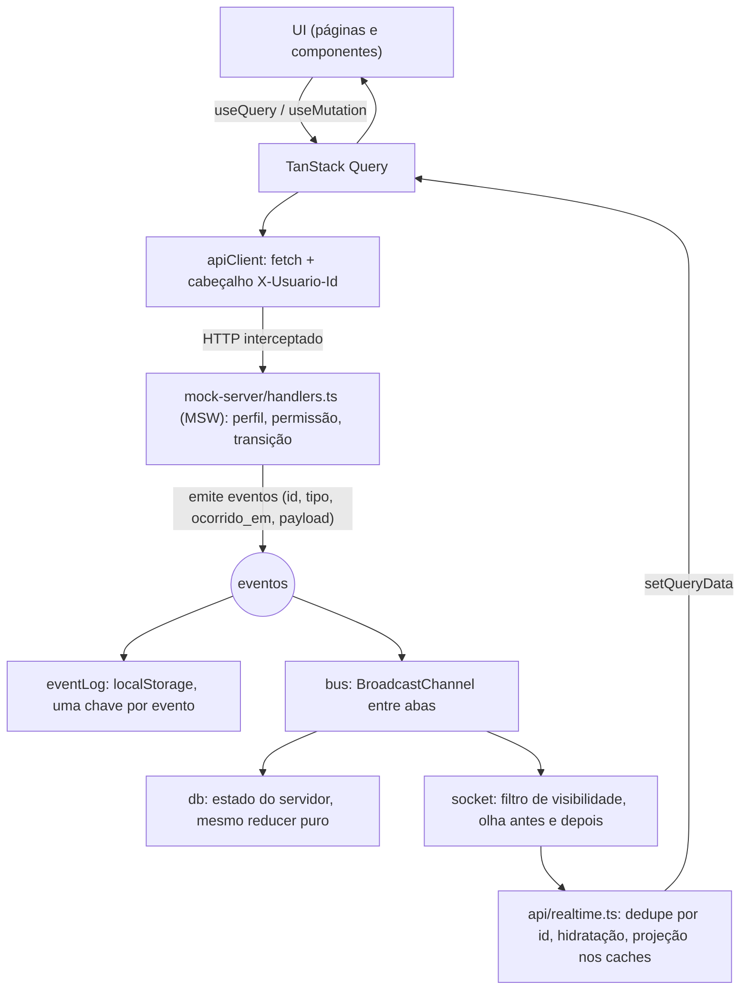

# Área de chamados (ITSM)

Resposta ao teste técnico de Frontend. É a área de chamados de um ITSM, em React 19 e TypeScript estrito, vista por três perfis: consultora, gestor e cliente. Não há backend. A API e o WebSocket rodam no navegador, num service worker do MSW, e falam o contrato de eventos do enunciado. O centro da entrega é a arquitetura do front: organização por feature, estado de servidor separado do estado de tela, regras de domínio em funções puras e um fluxo de tempo real idempotente entre abas. Tudo pensado para um time manter por anos.

## Sumário

- [Roteiro de 5 minutos para avaliar](#roteiro-de-5-minutos-para-avaliar)
- [Rodar](#rodar)
- [Entrar como cada perfil](#entrar-como-cada-perfil)
- [Arquitetura do front](#arquitetura-do-front)
- [O que cada perfil vê e por quê](#o-que-cada-perfil-vê-e-por-quê)
- [O que o dados.json esconde (e como o app trata)](#o-que-o-dadosjson-esconde-e-como-o-app-trata)
- [Testes](#testes)
- [Decisões](#decisões)
- [O que ficou de fora](#o-que-ficou-de-fora)

## Roteiro de 5 minutos para avaliar

1. Rode `pnpm install && pnpm dev` e abra http://localhost:5173.
2. Entre como Marina: `marina.almeida@suporte.example`, código `123456`. Ou clique em "Quem posso ser?" e escolha Marina.
3. A fila abre na aba "Meus", ordenada por "Estoura primeiro". Abra o chamado do topo: é o que estourou o prazo há mais tempo.
4. Responda ao cliente na caixa de resposta. Troque para "Nota interna" e veja a caixa ficar âmbar e o botão virar "Salvar nota".
5. Abra uma segunda aba no mesmo navegador. Entre como Helena (`helena.fernandes@lusitania.example`, `123456`), abra um chamado dela e mande uma mensagem. Volte à aba da Marina: a mensagem chega sem recarregar. Se ela estiver digitando no mesmo chamado, aparece "1 mensagem nova" e o texto dela não se mexe.
6. Numa terceira aba, entre como Ricardo (`ricardo.monteiro@suporte.example`). Veja quem está "Sobrecarregado", clique no nome de um consultor, marque chamados e use "Redistribuir para…".
7. No rodapé, o simulador começa pausado, para a tela abrir exatamente com o `dados.json`. Clique em "Retomar simulador" e troque para 20x. Clientes respondem, consultores pegam chamados, prazos estouram na frente de você.
8. "Resetar dados" no rodapé apaga tudo o que foi feito e volta ao `dados.json` puro.

## Rodar

Node 24 (`.nvmrc`), pnpm 10 (`packageManager` no `package.json`).

    pnpm install
    pnpm dev          # http://localhost:5173
    pnpm test         # Vitest
    pnpm test:e2e     # Playwright, porta própria 5180
    pnpm typecheck
    pnpm build && pnpm preview

Não há backend nem variável de ambiente. A API roda dentro do navegador, num service worker do MSW (`public/mockServiceWorker.js`, versionado de propósito).

## Entrar como cada perfil

O login é fake e tem dois passos: o e-mail, depois um código de 6 números. Nenhum e-mail é enviado. O código de todos é `123456`.

| Perfil | Quem | E-mail | Tela inicial |
|---|---|---|---|
| Consultora | Marina Almeida | marina.almeida@suporte.example | /fila |
| Gestor | Ricardo Monteiro | ricardo.monteiro@suporte.example | /equipe |
| Cliente | Helena Fernandes | helena.fernandes@lusitania.example | /meus-chamados |

- Os 48 usuários do `dados.json` entram com o mesmo código: 1 gestor, 12 consultores e 35 clientes.
- "Quem posso ser?" na tela de login lista os três. Clicar num deles preenche o e-mail e já leva ao passo do código.
- O código entra sozinho no sexto número.
- Cada passo simula latência de rede (700 ms no e-mail, 900 ms no código). O botão mostra carregamento ("Entrando…") e fica `aria-busy` enquanto espera.
- A sessão é por aba (`sessionStorage`). Abra duas abas, entre como Marina numa e Helena na outra, e converse entre elas.

## Arquitetura do front

Esta é a parte que mais importa na entrega. Cada tópico diz o que é, por que foi assim e onde está no código.

### 1. Organização por feature

**O quê.** O código é agrupado pelo que o usuário faz, não pelo tipo de arquivo.

| Pasta | Papel |
|---|---|
| `src/app/` | Composição: rotas, guardas, providers, casca da página e painel do simulador |
| `src/features/auth/` | Login em dois passos |
| `src/features/chamados/` | Fila da consultora, detalhe, conversa, abrir, pegar, mudar status, tela da cliente |
| `src/features/equipe/` | Painel do gestor e redistribuição |
| `src/shared/` | O que mais de uma feature usa: componentes, hooks, regras puras, tipos, estilos |
| `src/api/` | `apiClient`, queries do TanStack Query e o `realtime` que projeta eventos nos caches |
| `src/state/` | Sessão (Zustand). Só isso |
| `src/mock-server/` | O "backend": dados, log de eventos, bus, handlers MSW, socket, simulador |
| `src/tests/` | Setup do Vitest e fixtures |

**Regras.**

- Uma feature não importa outra. `auth`, `chamados` e `equipe` só importam de `shared/`, `api/` e `state/`. Quem junta tudo é `app/routes/index.tsx`.
- Cada feature expõe um barrel (`index.ts`) com o que é público. As rotas importam `@/features/chamados`, nunca um arquivo interno.
- Alias `@/` aponta para `src/` (`vite.config.ts`, `vitest.config.ts`, `tsconfig.app.json`). Nada de `../../../`.
- Componente ou página com CSS Module próprio ganha uma pasta com `.tsx`, `.module.css` e o teste juntos. Componentes que dividem um módulo (os do detalhe do chamado, os do painel do gestor) ficam lado a lado na mesma pasta.
- Testes ficam ao lado do código que testam.

**Por quê.** O enunciado diz que o sistema será mantido por este time durante anos. Por feature, uma mudança na tela do gestor fica em `features/equipe/`, e apagar uma feature não deixa sobra espalhada. A regra de não importar entre features evita o acoplamento que transforma um app grande num novelo. O barrel deixa explícito o que é contrato e o que é detalhe interno.

**Onde no código.** A árvore abaixo é o `src/` real (pastas e arquivos principais).

```
src/
├── main.tsx                      # sobe o mock-server e depois o React
├── app/
│   ├── App.tsx                   # providers: Query, Realtime, Toast
│   ├── routes/
│   │   ├── index.tsx             # todas as rotas, React Router declarativo
│   │   └── RotaProtegida.tsx     # guarda de sessão e de perfil
│   ├── providers/                # QueryProvider, RealtimeProvider
│   └── layout/                   # Casca, Cabecalho, PainelSimulador
├── features/
│   ├── auth/
│   │   ├── index.ts              # barrel
│   │   ├── pages/LoginPage/      # LoginPage.tsx + .module.css + .test.tsx
│   │   ├── components/CampoCodigo/
│   │   └── services/entrar.ts    # pedirCodigo, entrar, PERSONAS
│   ├── chamados/
│   │   ├── index.ts
│   │   ├── pages/                # FilaConsultorPage, ChamadoPage, MeusChamadosPage, NovoChamadoPage
│   │   ├── components/           # DetalheChamado/, ListaChamados/, LinhaChamado/, Novidades/, Trilha/
│   │   ├── hooks/useAlertaSla.ts # toast uma vez por faixa de prazo
│   │   └── utils/                # fila.ts, cliente.ts, categoriasAmigaveis.ts
│   └── equipe/
│       ├── index.ts
│       ├── pages/EquipePage/
│       └── components/           # CartaoConsultor, Redistribuir, TabelaChamados
├── shared/
│   ├── components/               # Badge, BadgePrazo, Button, Campo, Dialog, Estado, Select, Tabs, Toast
│   ├── hooks/                    # useNow, useUltimaVisita
│   ├── utils/                    # regras puras: reducer, sla, status, visibilidade, equipe, similaridade, datas, relogio, rotas
│   ├── types/                    # dominio.ts, evento.ts
│   └── styles/                   # tokens.css, reset.css
├── api/
│   ├── apiClient.ts              # fetch + X-Usuario-Id
│   ├── realtime.ts               # dedupe, hidratação, projeção nos caches
│   └── queries/                  # chaves.ts, chamados.ts, lookups.ts
├── state/sessao.ts               # Zustand + sessionStorage
├── mock-server/
│   ├── index.ts                  # iniciarMockServer
│   ├── handlers.ts               # rotas MSW, validação, eventos derivados
│   ├── db.ts                     # estado do "servidor" com o mesmo reducer
│   ├── eventLog.ts               # localStorage, uma chave por evento
│   ├── bus.ts                    # BroadcastChannel (fallback: evento storage)
│   ├── socket.ts                 # filtro de visibilidade por usuário
│   ├── simulator.ts              # atividade de fundo, Web Lock
│   └── dados.json                # cópia de material/dados.json
└── tests/                        # setup.ts, fixtures/dados.ts
```

### 2. Fluxo de dados

**O quê.** Toda escrita vira um evento no formato do enunciado. A tela nunca altera o próprio cache depois de uma mutation: ela muda quando o evento volta pelo socket. É o mesmo caminho para a ação desta aba, para a de outra aba e para o simulador.



O mesmo fluxo em texto:

```
UI → TanStack Query → apiClient (fetch, X-Usuario-Id) → MSW handlers
   → eventos → eventLog (localStorage, 1 chave por evento) + bus (BroadcastChannel)
   → db (reducer puro) → socket (visibilidade, antes/depois)
   → realtime (dedupe por id, hidratação substitui fatias, projeção nos caches) → UI
```

**Por quê.** Um caminho só para toda mudança elimina a classe de bug "a tela de quem fez a ação mostra uma coisa e a dos outros mostra outra". O "servidor" (`db.ts`) e o cliente (`realtime.ts`) aplicam o mesmo `reducer.ts`, então concordam por construção. As mutations ficam triviais: só fazem o POST.

**Onde no código.** `src/api/queries/chamados.ts` (comentário "As mutations não mexem no cache"), `src/api/apiClient.ts`, `src/mock-server/handlers.ts`, `src/mock-server/db.ts`, `src/mock-server/socket.ts`, `src/api/realtime.ts`, `src/shared/utils/reducer.ts`.

### 3. Estado de servidor e estado de tela

| Tipo de estado | Onde vive | Exemplos |
|---|---|---|
| Dado do servidor | TanStack Query | chamados, detalhe, histórico, últimas mensagens, usuários, grupos, categorias, SLA |
| Sessão | Zustand, gravado em `sessionStorage` (`itsm:sessao`) | usuário logado nesta aba |
| Estado de tela | `useState` no componente | aba ativa, filtro, texto da caixa, chamados marcados |
| Preferência por usuário | `localStorage` | última visita da cliente (`useUltimaVisita`) |

**Por quê.**

- Dado de servidor tem cache, revalidação e estado de carregamento próprios. O TanStack Query resolve isso, e o `realtime` só escreve nos caches com `setQueryData`.
- A sessão é o único estado global de verdade. Zustand faz isso num arquivo de 22 linhas, sem provider, e `usuarioAtual()` é lido fora do React pelo `apiClient` e pelo socket.
- Sem Redux. Com o servidor no TanStack Query, sobraria para o Redux só a sessão. Reducers, actions e middleware seriam cerimônia sem retorno.
- Sessão por aba porque, com `localStorage`, entrar como Helena numa aba trocaria o usuário da aba da Marina.

**Onde no código.** `src/app/providers/QueryProvider.tsx` (`staleTime` 30 s, lookups com 1 h em `api/queries/lookups.ts`), `src/api/queries/chaves.ts`, `src/state/sessao.ts`, `src/shared/hooks/useUltimaVisita.ts`.

### 4. Tempo real

**Contrato.** Os quatro eventos do enunciado, sem campo a mais: `chamado.aberto`, `chamado.atribuido`, `mensagem.adicionada`, `status.alterado`. Todo evento tem `id` (UUID), `tipo`, `ocorrido_em` (UTC) e `payload`. Tipos em `src/shared/types/evento.ts`.

| Peça | Como funciona | Onde |
|---|---|---|
| Idempotência | O reducer guarda `idsAplicados`. Evento com `id` já visto devolve o mesmo estado, e o `realtime` descarta sem projetar | `shared/utils/reducer.ts`, `api/realtime.ts` |
| Duplicados de propósito | Com o simulador ligado, cerca de 1 em 10 eventos é publicado duas vezes, porque o enunciado avisa que isso acontece. O rodapé conta os descartados | `mock-server/index.ts` (`deveDuplicar`), `mock-server/bus.ts` |
| Multi-aba | `BroadcastChannel` entre abas. Sem ele, o bus escuta o evento `storage` | `mock-server/bus.ts` |
| Persistência | Cada evento numa chave `itsm:evt:<ocorrido_em>:<id>`. Ao abrir, a aba carrega o `dados.json` e reaplica o log em ordem | `mock-server/eventLog.ts`, `mock-server/db.ts` |
| Visibilidade | O socket de cada aba filtra pelo usuário logado. Olha o chamado antes e depois do evento, para que a reatribuição que tira um chamado da visão também chegue | `mock-server/socket.ts`, `shared/utils/visibilidade.ts` |
| Simulador | Roda em uma aba só, a que obtém o Web Lock `itsm:simulador`. Faz requisições pelos mesmos handlers, com o usuário simulado no cabeçalho | `mock-server/simulator.ts`, `app/layout/PainelSimulador/` |
| Relógio virtual | Nasce em `meta.agora` (03/11/2026 13:00 UTC) e anda em 1x, 5x ou 20x. Gravado em `localStorage`, então todas as abas concordam | `shared/utils/relogio.ts` |
| "Agora" na tela | `useNow()` é a única fonte de "agora". É chamado no topo de cada página (e do detalhe) e passado para baixo como prop, então todos os prazos de uma tela usam o mesmo instante | `shared/hooks/useNow.ts` |

**Por quê.** Só multi-aba deixaria a tela parada quando o avaliador abre uma aba. Só simulador não mostraria a conversa entre duas pessoas. O lock evita que cada aba aberta multiplique a atividade. A duplicação existe para o dedupe ser visto funcionando. O relógio virtual existe porque, com o relógio real, todos os prazos do arquivo já estariam estourados (o último é 06/11/2026). Em 20x, um prazo de 2h estoura em 6 minutos.

**Detalhes que evitam bugs.**

- O `db` assina o bus antes de carregar o `dados.json`. Evento que chega durante o import fica pendente e é aplicado depois.
- Quando uma query busca dados, o `realtime` é hidratado com o que veio: a lista de chamados substitui a fatia de chamados, o detalhe substitui a conversa e o histórico daquele chamado. O cache não acumula estado velho.
- O reducer não infere efeitos. Pegar um chamado `aberto` faz o handler emitir `chamado.atribuido` e `status.alterado`, como o histórico do arquivo mostra.

### 5. Regras de domínio em funções puras

**O quê.** Toda regra de negócio está em `src/shared/utils/`, sem React e sem `fetch`. O "agora" entra como parâmetro. A única exceção é `relogio.ts`, que é o próprio relógio.

| Arquivo | Regra |
|---|---|
| `reducer.ts` | Aplica um evento ao estado, com dedupe por `id`. Roda no "servidor" e no cliente |
| `sla.ts` | Prazo relevante (1ª resposta ou resolução), faixas de SLA, ordenação "Estoura primeiro", cálculo de prazos |
| `status.ts` | Tabela de transições por perfil, motivos automáticos, motivos sugeridos e todos os rótulos de status |
| `visibilidade.ts` | Quem vê qual chamado, qual mensagem e qual parte do histórico |
| `equipe.ts` | Agregados do gestor, tempo sem chamado atribuído nos últimos 7 dias, sugestão de destino da redistribuição |
| `similaridade.ts` | Título parecido com um chamado resolvido ou fechado da mesma cliente nos últimos 90 dias |
| `datas.ts` | Formatação com `Intl`, no locale e fuso de cada usuário |
| `relogio.ts` | Relógio virtual com velocidade e reancoragem |
| `rotas.ts` | `ROTA_INICIAL` por perfil |

**Por quê.** Regra pura se testa sem montar tela, sem mock de rede e sem esperar. A mesma tabela de transições é lida pela tela (que esconde a ação proibida) e pelo handler (que responde `400`), então os dois nunca divergem. Quando o backend real chegar, essas regras viram a especificação que ele precisa respeitar.

**Onde no código.** `src/shared/utils/`, cada arquivo com seu `.test.ts` ao lado (exceto `rotas.ts` e `demo.ts`, que são constantes).

### 6. Rotas e guardas por perfil

- React Router 7 no modo declarativo (`<BrowserRouter>` e `<Routes>`), num arquivo só: `src/app/routes/index.tsx`.
- `RotaProtegida` sem `perfis` exige sessão e manda para `/entrar` guardando a rota de origem. Com `perfis`, mostra "Sem acesso" com um link para a tela do perfil.
- `/` redireciona para `ROTA_INICIAL[perfil]`: `/fila`, `/equipe` ou `/meus-chamados`.
- `/chamados/:id` serve os três perfis. O detalhe muda conforme quem olha: `DetalheChamado` serve a equipe e, para a cliente, renderiza `DetalheCliente`.
- A casca (`app/layout/Casca`) traz o cabeçalho com navegação por perfil e "Sair" (que também limpa o cache do TanStack Query), e o painel do simulador no rodapé. A trilha (`features/chamados/components/Trilha`) leva de volta à fila ou à lista.
- Rota desconhecida mostra "Página não encontrada".

**Por quê.** Ver todas as rotas num arquivo responde em segundos "quem acessa o quê". O modo declarativo basta: não há loaders porque os dados vêm do TanStack Query.

### 7. Estilo

- CSS Modules com design tokens em custom properties: `src/shared/styles/tokens.css`. As cores de SLA (`--sla-ok`, `--sla-critico`, `--sla-vencido`, `--sla-pausado`...) ficam num lugar só.
- `src/shared/styles/reset.css` para o reset e o `prefers-reduced-motion` global.
- Primitivos Radix sem estilo (Dialog, Select, Tabs, Toast), embrulhados em `src/shared/components/` com CSS próprio.
- Sem Tailwind. O teste não avalia identidade visual e o volume de estilo é pequeno. Mais uma ferramenta de build e um vocabulário de classes não pagam o custo. CSS Modules é CSS puro, escopo por arquivo, e qualquer pessoa do time lê.

**Por quê Radix.** Foco preso no diálogo, teclado no select e ARIA do toast são fáceis de errar à mão. O Radix resolve isso sem impor visual.

### 8. Acessibilidade e estados

- Foco visível com `:focus-visible` e anel de foco em token (`--anel-foco`).
- Diálogo, select, abas e toast com teclado e ARIA corretos (Radix).
- O alerta de prazo não depende só de cor: há texto ("Prazo estourado", "Estoura na próxima hora"), grupo com cabeçalho e contador.
- `aria-busy` nos botões de login, `role="status"` nas faixas de prazo, `aria-label` nos selos e nas caixas de seleção.
- `prefers-reduced-motion` desliga transições e troca rolagem suave por instantânea.
- As telas de dados têm os três estados: carregando, vazio e erro com "tentar de novo" (`src/shared/components/Estado/`). Quando o andamento de algum chamado da cliente não carrega, aparece um aviso em vez de uma tela incompleta e muda.
- Alvos de toque de 40px em telas estreitas.

### 9. Performance

- **Conversa virtualizada.** O #10609 tem 1.500 mensagens (o segundo maior tem 11). A conversa usa `@tanstack/react-virtual` com altura medida por item (`src/features/chamados/components/DetalheChamado/Conversa.tsx`).
- **`dados.json` fora do bundle inicial.** São 1,9 MB carregados por `import()` dinâmico em `src/mock-server/index.ts`.
- **Projeção no cache, não refetch.** Um evento atualiza os caches com `setQueryData`. Nenhum evento dispara nova requisição.
- **Agregados com `useMemo`.** Os números do gestor saem dos caches de chamados e histórico (620 chamados) e se atualizam sozinhos a cada evento.
- **A fila não é mais virtualizada.** Ela passou a ser agrupada por prazo com cabeçalho fixo, e cabeçalho fixo dentro de lista virtualizada é frágil. A fila de um consultor tem dezenas de chamados (42 da Marina, 35 na fila do grupo), o que o navegador renderiza sem esforço.

### 10. Trocar por um backend real

1. Apagar `src/mock-server/` e a chamada a `iniciarMockServer` em `src/main.tsx`.
2. Apontar `BASE_API` em `src/api/apiClient.ts` para a URL real e trocar o `X-Usuario-Id` pelo token de autenticação.
3. Implementar a interface `Socket` (`assinar`, `estado`) sobre um WebSocket de verdade e passá-la ao `RealtimeProvider`. O contrato de eventos não muda, e o dedupe por `id` continua valendo.
4. Remover o `PainelSimulador`, que é ferramenta de demonstração.

Fora o `main.tsx`, o app só importa tipos do `mock-server` (`MockServer`, `Socket`), e o painel do simulador importa a chave `CHAVE_SIMULADOR`. Features, queries e regras não sabem que o servidor é falso.

### 11. Versões

| Biblioteca | Versão | Por quê |
|---|---|---|
| React | 19.3 | Major estável, exigido pelo teste |
| Vite | 8.3 | Build e dev server, sem SSR porque não há backend |
| TypeScript | 5.9, estrito com `noUncheckedIndexedAccess` | O 7 acabou de sair |
| React Router | 7.18 | O 8 acabou de sair |
| TanStack Query | 5 | Estado de servidor, cache e revalidação |
| Zustand | 5 | Sessão por aba |
| MSW | 2.15 | API no service worker. O 3 acabou de sair |
| Vitest | 4.1 + Testing Library | O 5 acabou de sair |
| `@tanstack/react-virtual` | 3 | Conversa de 1.500 mensagens |
| Playwright | 1.56 | E2E |
| Radix | Dialog, Select, Tabs, Toast | Acessibilidade sem visual imposto |

O enunciado pede o que terá suporte nos próximos anos, não o recém-lançado. Por isso ficaram os majors estáveis, com tempo de mercado e suporte longo. Os majors estão fixados no `package.json`. Next.js ficou de fora porque, sem backend, tudo roda no navegador.

## O que cada perfil vê e por quê

### Marina, consultora

A dor dela: perder tempo procurando o chamado que está prestes a estourar o prazo.

- **Fila em duas abas.** "Meus" e "Fila do grupo" (a fila do grupo que ninguém pegou ainda).
- **Ordem padrão "Estoura primeiro".** Prazo estourado no topo, depois pelo tempo até o prazo relevante, SLA pausado depois, resolvido e fechado por último. O prazo relevante é o de primeira resposta enquanto não houve resposta, e o de resolução depois.
- **Agrupada pelo prazo, com cabeçalho fixo.** "Prazo estourado", "Estoura na próxima hora", "Estoura hoje" (até 23:59 no fuso dela), "Estoura depois de hoje", "SLA pausado" e "Resolvido ou fechado".
- **Contadores no topo.** Quatro números com os mesmos nomes. Clicar leva ao grupo.
- **Linha do chamado.** O tempo até o prazo é o elemento principal, com barra de prazo consumido e o tipo (1ª resposta ou resolução). O selo "mensagem do cliente" marca quando a última mensagem não interna é do solicitante.
- **Alerta.** Toast uma única vez por faixa: a menos de 4h, a menos de 1h e estourado. O título da aba do navegador mostra quantos estão com prazo estourado.
- **Escrever sem ser atropelada.** Mensagem nova no chamado aberto não rola a conversa nem mexe no texto. Aparece "1 mensagem nova" acima da caixa.
- **Detalhe.** Stepper com os cinco status (e a marca de reaberto), faixa de prazo ("Prazo de resolução estoura em 2h", "SLA pausado: aguardando cliente") e mensagens e mudanças de status numa linha do tempo só.
- **Nota interna.** Fundo próprio e rótulo "só a equipe vê". Na caixa, o modo nota deixa a caixa âmbar e o botão vira "Salvar nota".
- **Motivo como lista.** "Mudar status" oferece numa lista os motivos que já existem em `historico.motivo` do `dados.json` para aquela transição, mais "Outro motivo" com texto livre. Com uma única sugestão, ela já vem marcada. O motivo continua obrigatório.
- **Destaque verde ao terminar.** Resolvido ou fechado: o stepper fica verde, a faixa diz "Resolvido em {data}" e se foi dentro do prazo de resolução, e um toast confirma "Chamado #N resolvido".

### Ricardo, gestor

A dor dele: o sistema antigo mostra tudo e por isso não mostra nada.

- **Três números clicáveis no topo.** Com prazo estourado, estouram na próxima hora e na fila, ninguém pegou.
- **Um cartão por consultor dos dois grupos.** "Em atendimento" e "Aguardando cliente" separados, "Prazo estourado", "Estoura em até 4 h" e o tempo sem chamado atribuído nos últimos 7 dias.
- **Ordem por quem está pior.** Mais prazo estourado primeiro, depois mais em atendimento e aguardando cliente.
- **"Sobrecarregado".** Quem tem 15 ou mais chamados com prazo estourado ganha o selo, o atalho "Redistribuir" e uma sugestão de destino (mesmo grupo, menos chamados, mais tempo sem chamado atribuído). A sugestão só informa. Quem escolhe é ele.
- **"Sem chamado atribuído".** Quem está sem nada aparece marcado.
- **Duas tabelas lado a lado.** "Estouram o SLA nas próximas 4 horas" e "Fila do grupo que ninguém pegou", com atribuir ou reatribuir na linha.
- **Redistribuir em lote.** Clicar no nome do consultor lista os chamados dele, com seleção múltipla e "Redistribuir para…". O destino é limitado ao grupo dos chamados marcados. Marcar chamados de grupos diferentes mostra "Selecione chamados de um mesmo grupo".
- **Conversa a um clique.** Existe, mas não ocupa o painel, porque ele raramente a abre.

### Helena, cliente

A dor dela: não sabe o que é categoria, grupo ou prioridade, e quer entender o que aconteceu sem reler tudo.

- **Sem jargão.** Ela não vê categoria, grupo nem prioridade. Um texto por status: "Aguardando atendimento", "Em atendimento", "Aguardando sua resposta", "Resolvido, aguardando sua confirmação", "Fechado".
- **No horário dela.** Datas no fuso e locale dela (`Europe/Lisbon`, `pt-PT`). Prazo estourado aparece como "passou do prazo".
- **"Novidades desde a sua última visita".** Frases como "Juliana Pereira pegou o seu chamado", para ela não reler tudo.
- **Próximo passo em cada cartão.** Prazo estourado, aguardando você ou com a equipe. Os fechados ficam separados, embaixo.
- **Detalhe.** Stepper com um passo por status, quem está cuidando e "O que aconteceu até agora" em frases, sem o prazo interno de SLA.
- **Abrir chamado.** "O que parou?" com opções visíveis e nomes amigáveis para cada categoria.
- **Mesmo problema de novo.** Se o título lembra um chamado dela resolvido ou fechado nos últimos 90 dias, o app pergunta se é o mesmo problema e oferece reabrir.
- **Reabrir e confirmar.** "Ainda não resolveu" e "Resolvido? Confirmar" no chamado resolvido. Reabrir um fechado pede "Conte o que aconteceu".

O vocabulário de cada rótulo da tela, com a origem no `dados.json` ou no enunciado, está em [`docs/decisoes.md`](docs/decisoes.md#vocabulário-da-tela).

## O que o dados.json esconde (e como o app trata)

Cada fato abaixo foi conferido no `material/dados.json`.

| Fato no arquivo | Como o app trata |
|---|---|
| O #10608 tem Marina como responsável, mas é do grupo Aplicações. Ela é de Infraestrutura | A regra de visibilidade inclui "responsável vê o chamado mesmo fora do grupo" (`visibilidade.ts`). A reatribuição que tira o #10608 dela também chega à aba dela, porque o socket olha antes e depois. Redistribuir o #10608 só oferece consultores de Aplicações |
| O #10613 está em `aguardando_cliente`, mas a cliente já respondeu duas vezes depois da mudança | O app não corrige o arquivo: o reducer aplica eventos e não deduz status. O selo "mensagem do cliente" na fila e "Última mensagem do cliente" no detalhe mostram a situação à consultora. Daqui para a frente, resposta da cliente em `aguardando_cliente` faz o handler emitir `status.alterado` com "Cliente respondeu" |
| O #10611 foi reaberto. O histórico diz "Fechado automaticamente após 5 dias sem resposta", mas fechou um dia depois de resolvido. E continua com `resolvido_em` e `fechado_em` preenchidos | O histórico é mostrado como veio, sem reescrever o motivo. Toda derivação usa `status`, nunca `resolvido_em` ou `fechado_em`, que mentiriam aqui. O stepper mostra a marca de reaberto |
| O título do #10608 tem 318 caracteres | Reticências na linha da fila e na tabela do gestor (`text-overflow: ellipsis`). O título inteiro aparece no detalhe, quebrando linha |
| O #10609 tem 1.500 mensagens. Todos os outros têm 11 ou menos | Conversa virtualizada com altura medida por item |
| O #10612 (fechado) e o #10614 (aberto) da Helena têm o mesmo título, com "(outra vez)" no segundo | É o caso real da sugestão de reabertura. Digitar o título do #10614 sugere o #10612 |
| 76 chamados em `aguardando_cliente` e exatamente 76 com `sla_pausado` | A pausa é derivada do status. O chamado pausado sai da conta de prazo estourado |
| Com o relógio real, todos os prazos já teriam estourado. O último é 06/11/2026 | Relógio virtual que parte de `meta.agora` (03/11/2026 13:00 UTC) |

## Testes

### Vitest

    pnpm test

151 testes em 29 arquivos, com Vitest 4.1, jsdom e Testing Library. Rodam em cerca de 4 segundos.

| Camada | O que cobrem |
|---|---|
| Regras puras | Reducer (os quatro eventos, dedupe, primeira resposta), faixas de SLA e "Estoura primeiro", tabela de transições, visibilidade (#10608), similaridade (par #10612/#10614), tempo sem chamado atribuído, datas, relógio virtual |
| Mock-server | Handlers (eventos derivados, `409` ao pegar chamado com dono, `400` sem motivo ou fora da tabela, permissões por perfil, número, grupo e prazos), socket filtrando por perfil (inclusive o evento que tira o chamado da visão), bus, log, db, simulador |
| API | `apiClient` e `realtime` (projeção nos caches, dedupe) |
| Tela | Login dos três perfis, campo de código, alerta de prazo uma vez por faixa, conversa que não rola enquanto se digita, motivo obrigatório no diálogo de status, sugestão de reabertura, redistribuição limitada ao grupo, aviso quando o andamento de um chamado não carrega |

### E2E (Playwright)

    pnpm exec playwright install chromium   # uma vez
    pnpm test:e2e

9 testes em 7 arquivos, no Chromium. O Playwright sobe o app numa porta própria (5180, `playwright.config.ts`) para não colidir com um `pnpm dev` em 5173. Cada teste começa com `localStorage` e `sessionStorage` limpos, então parte do `dados.json` puro.

Cobre os seis requisitos do enunciado, um por arquivo em `e2e/`, mais o tempo real entre abas:

1. `01-abrir-chamado.spec.ts`: Helena abre um chamado, cai no detalhe e ele aparece em "Meus chamados". Digitar o título do #10614 sugere reabrir o #10612.
2. `02-encontrar-e-ver.spec.ts`: Marina busca por número na fila, abre o chamado e vê conversa, status, responsável e prazo. A trilha volta em `/chamados/:id`.
3. `03-pegar-chamado.spec.ts`: Marina pega um chamado da aba "Fila do grupo" e ele passa para "Meus", em atendimento.
4. `04-trocar-mensagens.spec.ts`: Marina responde e deixa uma nota interna. A nota tem o rótulo "só a equipe vê" para Marina e não aparece para a cliente, logada em outra aba.
5. `05-status-motivo-reabrir.spec.ts`: Marina marca um chamado como resolvido (o diálogo exige motivo). Helena reabre um chamado fechado contando o que aconteceu.
6. `06-equipe.spec.ts`: Ricardo vê os 12 cartões de consultor, "Estouram o SLA nas próximas 4 horas" e "Fila do grupo que ninguém pegou", e redistribui o #10608 da Marina, que é do grupo Aplicações, para um consultor desse grupo.
7. `07-tempo-real.spec.ts`: duas abas do mesmo contexto (mesmo `localStorage`, `sessionStorage` separado). A mensagem enviada por Helena aparece na tela da Marina sem recarregar.

## Decisões

Cada decisão, com alternativas, o porquê e onde está no código, está em [`docs/decisoes.md`](docs/decisoes.md). A tabela de [vocabulário da tela](docs/decisoes.md#vocabulário-da-tela) mostra de onde sai cada rótulo, no `dados.json` ou no enunciado. A spec e o plano de implementação estão em `docs/superpowers/`.

## O que ficou de fora

- **Autenticação real e backend.** O teste pede só front e diz que não há backend. O login com e-mail e código serve para trocar de perfil.
- **Anexos e notificações por e-mail.** Não estão entre os seis requisitos e não mudam a decisão de o que mostrar na tela.
- **Busca full-text.** A fila busca por número, título ou nome do cliente, o que basta para os volumes do arquivo.
- **Relatórios além do painel do gestor.** O enunciado pede acompanhar o grupo, não relatórios.
- **Internacionalização da interface.** Os textos são em pt-BR. Só as datas seguem o locale e o fuso de cada usuário, porque é isso que importa para a Helena.
- **Layout mobile dedicado.** O layout se adapta a telas estreitas, mas o alvo é desktop.
- **Extensão do prazo pelo tempo pausado.** O chamado com SLA pausado sai da conta de prazo estourado, mas o prazo não é empurrado. O arquivo não traz o início de cada pausa.
- **Consultor abrir chamado em nome de cliente.** Só o cliente abre.
- **Abas abertas depois de "Resetar dados".** A aba que resetou recarrega sozinha. As outras precisam ser recarregadas à mão.
